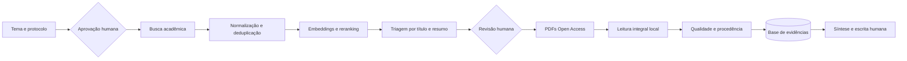

# TCC Research

Software aberto para organizar uma revisão de literatura de forma reproduzível: definição do
protocolo, busca em fontes acadêmicas, deduplicação, obtenção legal de PDFs, priorização com
modelos locais, leitura integral e construção de uma base auditável de evidências.

> Status: **alpha**. Use como apoio à pesquisa, nunca como substituto da avaliação do autor,
> orientador ou banca.

## O que o sistema faz

- cria projetos e protocolos para qualquer tema;
- exige aprovação humana antes de uma busca externa;
- pesquisa Crossref, OpenAlex, Semantic Scholar, DBLP, arXiv, OpenAIRE, DataCite e Europe PMC;
- coleta SciELO por mecanismos auditáveis e permite importar resultados institucionais;
- normaliza metadados e identifica duplicatas;
- localiza e valida PDFs Open Access sem contornar paywalls;
- prioriza artigos com embeddings, reranking e classificação generativa local;
- lê PDFs por página e preserva trechos, páginas, justificativas e incertezas;
- registra execuções idempotentes, métricas, decisões e checkpoints humanos.

A escrita automática do TCC permanece desabilitada nesta versão. O produto atual termina em um
conjunto validado de artigos e evidências. Isso impede que um agente escritor pesquise por conta
própria ou transforme conteúdo não verificado em afirmação acadêmica.

## Fluxo



## Início rápido com Docker

Requisitos: Git, Docker Desktop ou Docker Engine com Compose e pelo menos 4 GB livres para os
serviços básicos. GPU é opcional e utilizada somente nas etapas com modelos locais.

```bash
git clone URL_DO_SEU_FORK.git
cd tcc-research-os
cp .env.example .env
docker compose up -d --build
```

No PowerShell, substitua `cp` por:

```powershell
Copy-Item .env.example .env
```

Edite `.env` e informe um e-mail real em `ACADEMIC_API_EMAIL` e `UNPAYWALL_EMAIL`. A API estará
em <http://localhost:8000/docs>. O container executa as migrations automaticamente.

Crie um projeto de exemplo:

```bash
curl -X POST http://localhost:8000/v1/projects \
  -H "Content-Type: application/json" \
  --data @examples/project.example.json
```

O protocolo começa como `DRAFT`. Revise as consultas e critérios na documentação interativa,
aprove-o e somente depois habilite `ALLOW_LIVE_ACADEMIC_SEARCH=true`.

## Execução local sem Docker

```bash
python -m venv .venv
python -m pip install -e ".[dev]"
cp .env.example .env
```

Configure `DATABASE_URL` para uma instância PostgreSQL 16 com pgvector e execute:

```bash
alembic upgrade head
uvicorn tcc_research_os.main:app --reload
```

As migrations de produção usam recursos do PostgreSQL. SQLite é utilizado pelos testes
isolados, mas não é um banco de execução suportado para o pipeline completo.

## Documentação

- [Guia completo de uso](docs/GUIA_COMPLETO_DE_USO.md)
- [Modelos locais](docs/MODELOS_LOCAIS.md)
- [Integração com OpenClaw](docs/OPENCLAW_SETUP.md)
- [Como contribuir](CONTRIBUTING.md)
- [Política de segurança](SECURITY.md)

## Estrutura do repositório

```text
src/tcc_research_os/   API, conectores, serviços e CLIs
migrations/            versionamento do banco com Alembic
tests/                 testes offline
examples/              payloads reutilizáveis
docs/                  operação e arquitetura
openclaw/               prompts e workspaces isolados
storage/                PDFs e relatórios locais; ignorado pelo Git
```

## Segurança e ética

- não publique `.env`, banco, logs ou PDFs coletados;
- não contorne paywalls, autenticação ou CAPTCHAs;
- revise licenças antes do download;
- respeite limites e termos das fontes;
- trate decisões de IA como apoio, mantendo revisão humana;
- confira toda citação no PDF original antes da escrita.

## Desenvolvimento

```bash
python -m pip install -e ".[dev]"
ruff check .
pytest
```

O CI executa lint e testes em Python 3.10 e 3.12. Os testes não exigem internet, GPU, OpenClaw
ou chaves externas.

## Licença

Distribuído sob a [licença MIT](LICENSE). A licença do software não concede permissão para
redistribuir artigos ou outros conteúdos protegidos obtidos durante uma pesquisa.
